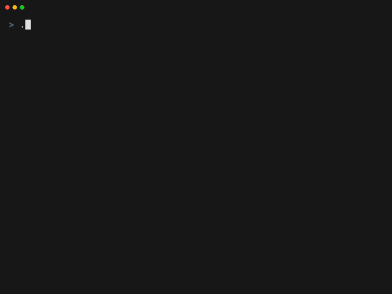

<p align="center">
  <a href="https://github.com/knuspii/crunchycleaner/actions">
    
  </a>
  <a href="https://github.com/knuspii/crunchycleaner/releases">
    
  </a>
  <a href="https://github.com/knuspii/crunchycleaner/releases">
    
  </a>
  <a href="https://github.com/knuspii/crunchycleaner">
    
  </a>
</p>

<div align="center">
<h1>CrunchyCleaner </h1>

</div>

### 🧹 A lightweight, software [cache](https://wikipedia.org/wiki/Cache_(computing)) cleanup tool for Windows & Linux.
> Made by: Knuspii, (M)
- **Cross-Platform:** Works on both **Windows** and **Linux**
- **Lightweight:** Single binary, no dependencies (just download and run it)
- **TUI (Text-UI):** Simple, minimalist interface, no confusing menus

---

## Supported Software List:
| Category | Software / Path |
| :--- | :--- |
| **System:** | System Logs, System Temp, Thumbnail, Shell History, Package Managers, Shader Cache |
| **Browsers:** | Firefox, Google Chrome, Microsoft Edge, Brave, Opera, Zen |
| **Apps:** | Steam, Epic Games(Heroic), Discord, Telegram, Spotify |
| **Development:** | Visual Studio Code, JetBrains IDE, Slack, Go, Pip, NPM, Yarn, Cargo, Electron, NuGet, Gradle, Playwright, Python uv, Node.js |

**Flatpak is supported** \
**Snap is NOT supported**

---

## 📥 How to Install & Download
### Easiest way:
[Simply download the latest release from here ⬇ and run the binary.](https://github.com/Knuspii/CrunchyCleaner/releases/latest) \
[](https://github.com/Knuspii/CrunchyCleaner/releases/latest)


### Alternative: Install via Terminal
If you prefer installing CrunchyCleaner through your terminal, use one
of the following commands.

**Linux (using sudo):**
``` bash
curl -L https://github.com/Knuspii/CrunchyCleaner/releases/latest/download/crunchycleaner -o cc && sudo install -m 755 cc /usr/local/bin/crunchycleaner && rm cc
```

**Windows (using PowerShell as Administrator):**
``` powershell
$d="$env:ProgramFiles\CrunchyCleaner"; md $d -F; iwr "https://github.com/Knuspii/CrunchyCleaner/releases/latest/download/crunchycleaner.exe" -OutFile "$d\crunchycleaner.exe"; $p=[Environment]::GetEnvironmentVariable('Path',2); if($p -notlike "$d"){[Environment]::SetEnvironmentVariable('Path',"$p;$d",2)}
```

**Go (using `go install`):**
``` bash
go install github.com/knuspii/crunchycleaner/v2@latest
```

After installation, restart your terminal and verify it by running:
``` bash
crunchycleaner -v
```

---

## Options:
```
  -a	Automate cleaning (select all and start immediately)
  -d	Dry-run mode without deleting files (for testing)
  -s	Show all hotkeys
  -v	Show version information
```

---

> [!WARNING]
> You use this tool at your own risk!

> [!NOTE]
> AI was used for this project in some parts. BUT THIS IS NOT VIBECODED!

## Q&A
**Q:** Will this break my system? \
**A:** No.\
\
**Q:** What does it actually delete? \
**A:** Only cache files and temp files.\
\
**Q:** Why another cleaner? \
**A:** Because this one is easy, simple, small and lightweight.

## Other Downloads
CrunchyCleaner is also available on SourceForge \
\
[](https://sourceforge.net/projects/crunchycleaner/files/latest/download)
[](https://sourceforge.net/projects/crunchycleaner/files/latest/download)

---

### 🎖️ Featured on
 - [Awesome TUIs](https://github.com/rothgar/awesome-tuis)
 - [Awesome Go](https://github.com/avelino/awesome-go)
 - [Awesome Windows](https://github.com/0PandaDEV/awesome-windows)
 - [Linux Links](https://www.linuxlinks.com/crunchycleaner-lightweight-cache-cleanup-tool)

### External Dependencies
This project uses the following external dependencies:
- **[github.com/eiannone/keyboard](https://github.com/eiannone/keyboard)** – used for cross-platform keyboard input (MIT License)
- **[golang.org/x/term](https://pkg.go.dev/golang.org/x/term)** – used for the menu list (BSD 3-Clause License)
- **[github.com/shirou/gopsuti](https://github.com/shirou/gopsutil)** – used for cross-platform system and hardware metrics (BSD 3-Clause License)
